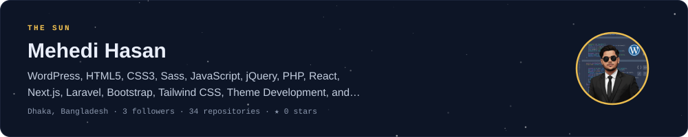
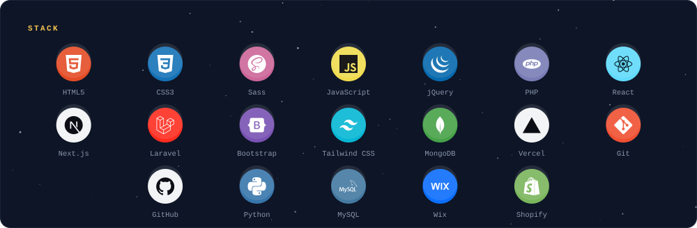
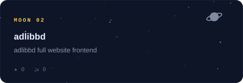
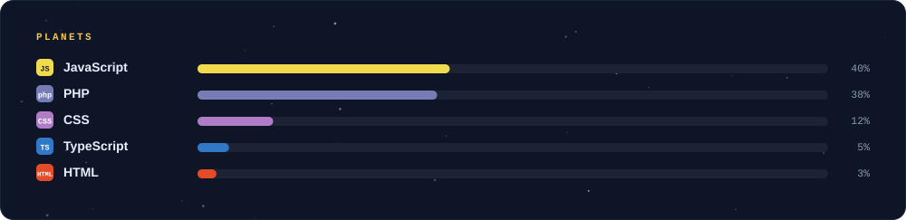
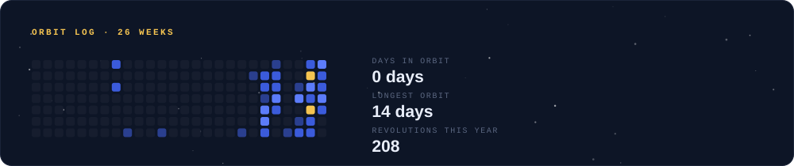

<!--
  Panels are generated by scripts/generate.mjs and committed to assets/.
  The GitHub Action in .github/workflows/solar-readme.yml refreshes them daily.
  No third-party service is involved — every image below is a file in this repo.
  The orbits animate with SMIL, and the avatar is inlined as base64 (GitHub blocks
  remote images inside an SVG), so both work with no JavaScript and no requests.
-->

I am the sun; my stack are the planets and my projects their moons.

<!-- moons:start -->
 
<!-- moons:end -->

[GitHub](https://github.com/devmehedihasun) · [Website](https://devmh.com/) · [X](https://x.com/Mahedih44930089)

Solar System · the planets really orbit · planets are languages, comets are recent pushes · built and rendered in this repo
