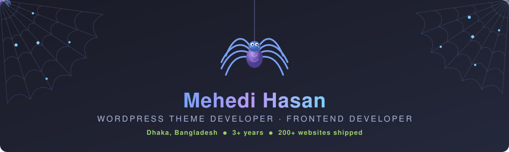

<!-- ╔══════════════════════════════════════════════════════════════╗
     ║  ANIMATED SPIDER BANNER                                      ║
     ║  Lives at assets/spider-banner.svg in THIS repo.             ║
     ║  Must be an  — GitHub strips inline <svg> from markdown ║
     ╚══════════════════════════════════════════════════════════════╝ -->
<p align="center">
  
</p>

<!-- ===== TYPING ANIMATION ===== -->
<p align="center">
  <a href="https://devmh.com/">
    
  </a>
</p>

<!-- ===== BADGES ===== -->
<p align="center">
  
  <a href="https://github.com/devmehedihasun?tab=repositories&sort=stargazers">
    
  </a>
  <a href="https://github.com/devmehedihasun?tab=followers">
    
  </a>
</p>

---

## 🧑🏻‍💻 About Me

```javascript
const mehedi = {
    location: "Dhaka, Bangladesh 🇧🇩",
    role: "WordPress Theme Developer @ solvenixtech",
    experience: "3+ years in web development",
    record: "200+ websites · 95% client satisfaction · 90% 5-star",
    learning: ["Advanced Theme Dev", "React", "Next.js", "GSAP"],
    values: ["clean code", "teamwork", "clear communication"],
    mission: "Join a product-based company & keep growing 🚀"
};
```

<!-- Collapsible sections are the one genuinely interactive element GitHub allows -->
<details>
<summary><b>🪄 &nbsp;What I actually do all day &nbsp;<i>(click to expand)</i></b></summary>
<br>

| | |
|---|---|
| 🔭 **Currently** | Building custom WordPress themes & modern frontends at **solvenixtech** |
| 🌱 **Learning** | Advanced theme architecture, React patterns, GSAP motion design |
| 💬 **Ask me about** | WordPress theming, plugin development, responsive frontend, Laravel |
| ⚡ **Fun fact** | I've shipped **200+ websites** with a **90% 5-star** rating |
| 📫 **Reach me** | [devmh.com](https://devmh.com/) |

</details>

<details>
<summary><b>🛠️ &nbsp;How I build a theme, start to finish &nbsp;<i>(click to expand)</i></b></summary>
<br>

1. **Discovery** — clarify scope, audience and must-have features with the client
2. **Design hand-off** — pull the Figma file apart into reusable components
3. **Scaffold** — set up the theme structure, `functions.php`, enqueue strategy
4. **Build** — semantic HTML, SASS architecture, mobile-first breakpoints
5. **Dynamic** — ACF / customizer fields so the client can edit everything
6. **Polish** — GSAP micro-interactions, Lighthouse pass, cross-browser QA
7. **Hand-off** — documentation + a walkthrough so nothing is a black box

</details>

---

## 🚀 Skills & Technologies

<p align="center">
  &nbsp;&nbsp;
  &nbsp;&nbsp;
  &nbsp;&nbsp;
  &nbsp;&nbsp;
  &nbsp;&nbsp;
  &nbsp;&nbsp;
  
</p>
<p align="center">
  &nbsp;&nbsp;
  &nbsp;&nbsp;
  &nbsp;&nbsp;
  &nbsp;&nbsp;
  &nbsp;&nbsp;
  &nbsp;&nbsp;
  
</p>

---

## 📊 GitHub Stats

<!-- Streak card — confirmed working -->
<p align="center">
  
</p>

<!-- profile-summary-cards: used instead of github-readme-stats.vercel.app,
     which has been returning 503 / "deployment paused" -->
<p align="center">
  
</p>
<p align="center">
  
  
  
</p>

<details>
<summary><b>🏆 &nbsp;More stats — trophies & activity graph &nbsp;<i>(click to expand)</i></b></summary>
<br>
<p align="center">
  
</p>
<p align="center">
  
</p>
<p align="center">
  
</p>
</details>

---

## 🐍 Watch the snake eat my contributions

<p align="center">
  
</p>

---

## 🤝 Connect With Me

<p align="center">
  <a href="https://devmh.com/"></a>
  <a href="https://x.com/Mahedih44930089"></a>
  <a href="https://www.facebook.com/share/1C6GCm8PeX/"></a>
  <a href="https://github.com/devmehedihasun"></a>
</p>

<p align="center">
  <i>🕸️ Thanks for crawling by — let's build something together.</i>
</p>


